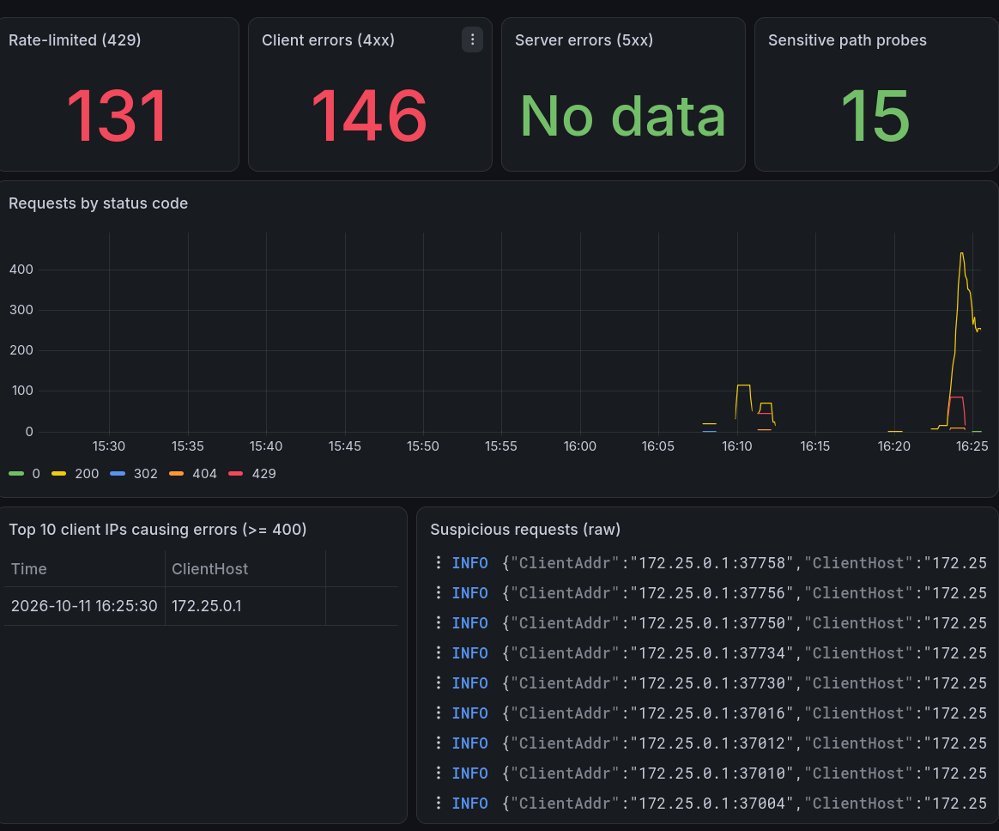
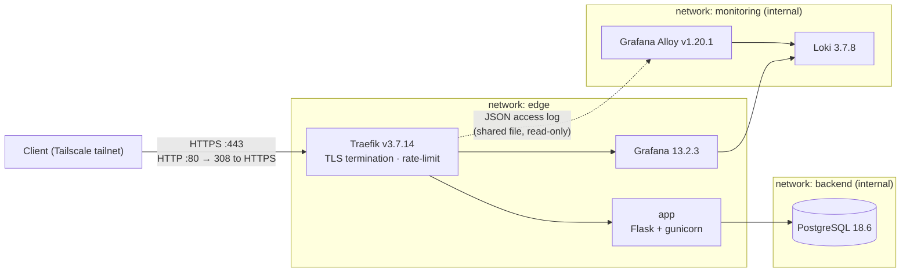

# pi-platform — Hardened self-hosted microservice stack on a Raspberry Pi 5

[](https://github.com/camelibob/pi-platform/actions/workflows/security.yml)

A small microservice platform running on a Raspberry Pi 5 (ARM64, Ubuntu) with Docker Compose.
The goal is not feature richness but **sound defaults**: network segmentation, non-root and read-only
containers, secrets kept out of the repository and out of container environments, edge rate-limiting,
and a security-oriented log pipeline.

> This is network segmentation and container hardening on a single host. It is **not** a zero-trust architecture.



---

## Architecture



| Service | Networks | Published ports | Runs as |
|---|---|---|---|
| traefik | edge | 80, 443 on the host's Tailscale IP only (only service exposed) | UID 65534 |
| app | edge, backend | none | UID 10001 |
| db | backend | none | `postgres` (entrypoint drops root) |
| loki | monitoring | none | image default (non-root) |
| alloy | monitoring | none | UID 65534 |
| grafana | edge, monitoring | none | image default (non-root) |

`backend` and `monitoring` are `internal: true`: no gateway, no outbound internet access, and services
outside them cannot even resolve their hostnames.

---

## Security choices and why

**No Docker socket anywhere.** Access to `/var/run/docker.sock` is root-equivalent on the host.
Traefik uses the *file provider* instead of the Docker provider, and Alloy reads Traefik's access log
from a shared file instead of using the Docker log collector. Trade-off: routes are declared by hand,
and only Traefik access logs are centralised.

**Non-root, read-only, no capabilities.** Every service uses `cap_drop: [ALL]` and
`no-new-privileges:true`. Traefik, the app, Loki, Alloy and Grafana run with a read-only root filesystem
(`tmpfs` for `/tmp` where needed). Traefik listens on 8080/8443 inside its container so it never needs
`NET_BIND_SERVICE`. PostgreSQL only gets the five capabilities its entrypoint needs to drop to the
`postgres` user (CHOWN, DAC_OVERRIDE, FOWNER, SETGID, SETUID).

**Segmentation.** PostgreSQL publishes no port and sits alone on an internal network shared only with
the app. Traefik cannot reach it (verified below).

**Published on the Tailscale address only.** The host sits on a shared campus network. Traefik's 80/443
are bound to the address set in `TRAEFIK_BIND_ADDR` (the host's Tailscale IP), not to `0.0.0.0`, so the
stack is unreachable from the local network and has no IPv6 listener. If the variable is unset, Compose
falls back to `127.0.0.1`: a missing setting closes the stack instead of opening it.
`net.ipv4.ip_nonlocal_bind = 1` lets Docker bind to that address at boot even before `tailscaled` has
brought the interface up (verified with a full reboot).

**Secrets as files, not environment variables.** The database password and the Grafana admin password
are Compose secrets mounted under `/run/secrets/`. Environment variables leak through `docker inspect`,
`/proc/*/environ` and child processes. `.env` holds only non-secret values and is git-ignored;
`.env.example` documents it.

**TLS.** Local CA (mkcert), wildcard certificate for `*.pi.home.arpa` (`home.arpa` is reserved for home
networks by RFC 8375). TLS ≥ 1.2, `sniStrict: true` (unknown SNI is rejected instead of being served a
default certificate), HTTP permanently redirected to HTTPS.

**Edge rate-limiting.** Traefik token bucket: `average: 10/s`, `burst: 20` for the app; a looser
`50/s, burst 100` for Grafana, whose UI loads many assets at once. Excess requests get `429` before
reaching the backend.

**No phoning home.** Traefik version check and usage stats, Loki analytics, Alloy reporting, Grafana
analytics, update checks and plugin pre-installation are all disabled. Updates are tracked manually.

**Pinned versions.** Every image is pinned to an exact patch tag; Python dependencies are frozen in
`app/requirements.txt`.

**Dashboard as code.** The Grafana datasource and the security dashboard are provisioned from files in
this repository (`allowUiUpdates: false`), so the monitoring setup is versioned and reproducible.

**Minimal error disclosure.** `/db-health` returns a generic `503` on failure, never a stack trace.

---

## Security dashboard

Built on Traefik's JSON access logs (`{job="traefik"}` in Loki):

- requests rejected by the rate-limit (`429`)
- client errors (4xx) and server errors (5xx)
- probes on sensitive paths (`/.env`, `/.git`, `wp-admin`, `wp-login`, `phpmyadmin`, `.php`)
- requests by status code over time
- top 10 client IPs causing errors
- raw stream of suspicious requests

A `404` on `/.env` is not noise: nobody requests it by accident. It is a reconnaissance signal, and the
dashboard shows who sent it, when, and what else the same source probed.

---

## Deploy

**Prerequisites:** Docker Engine and the Compose plugin on a 64-bit host, `mkcert` and `libnss3-tools`.

```bash
git clone git@github.com:camelibob/pi-platform.git && cd pi-platform

# 1. TLS certificate from a local CA
mkcert -install
mkdir -p certs
mkcert -cert-file certs/pi.home.arpa.pem -key-file certs/pi.home.arpa-key.pem "*.pi.home.arpa"
sudo chown 65534:65534 certs/pi.home.arpa-key.pem      # readable only by Traefik's UID

# 2. Secrets (never committed)
mkdir -p secrets && chmod 700 secrets
openssl rand -base64 32 | tr -d '\n' > secrets/db_password
openssl rand -base64 24 | tr -d '\n' > secrets/grafana_admin_password
chmod 644 secrets/*        # the directory is 700 on the host; containers need read access

# 3. Non-secret configuration
cp .env.example .env
# then set TRAEFIK_BIND_ADDR in .env to the host's Tailscale IP (tailscale ip -4)

# 4. Allow binding to the Tailscale IP before tailscaled is up at boot
echo "net.ipv4.ip_nonlocal_bind = 1" | sudo tee /etc/sysctl.d/99-nonlocal-bind.conf
sudo sysctl --system

# 5. Traefik access-log directory (written by Traefik's UID, read by Alloy)
mkdir -p logs && sudo chown 65534:65534 logs

# 6. Start
docker compose config --quiet && docker compose up -d
docker compose ps
```

Remote access goes through **Tailscale**: the Pi is not exposed to the internet, and clients reach it
on its tailnet IP. Clients need a hosts entry (`<pi-tailnet-ip> app.pi.home.arpa grafana.pi.home.arpa`) and the CA's **public**
certificate (`rootCA.pem` from `mkcert -CAROOT`) imported as a trusted authority. Never copy
`rootCA-key.pem` off the host.

---

## Verification

Run from the host (`TS_IP` = the host's Tailscale IP, `LAN_IP` = its campus-network IP):

```bash
# App reachable through Traefik, over HTTPS, on the Tailscale IP
curl -s --resolve app.pi.home.arpa:443:$TS_IP https://app.pi.home.arpa/db-health
# → {"db":"ok"}

# Not reachable on the local network
curl -s -m 5 -o /dev/null -w "%{http_code}\n" -k https://$LAN_IP
# → 000

# Only the Tailscale IP is listening on 80/443 (no 0.0.0.0, no [::])
sudo ss -tlnp | grep -E ':(80|443)\b'
# → $TS_IP:80 and $TS_IP:443 only

# App runs as non-root
docker compose exec app id
# → uid=10001(appuser)

# PostgreSQL not exposed on the host
sudo ss -tlnp | grep 5432 || echo "5432 not exposed"
# → 5432 not exposed

# Traefik cannot reach the database
docker compose exec traefik wget -T 3 -q -O- http://db:5432
# → wget: bad address 'db:5432'

# The database has no outbound internet access
docker compose exec db wget -T 3 -q -O- https://example.com
# → wget: bad address 'example.com'

# The DB password is not in the container environment
docker inspect pi-platform-db-1 --format '{{range .Config.Env}}{{println .}}{{end}}' | grep -i pass
# → POSTGRES_PASSWORD_FILE=/run/secrets/db_password

# Rate-limit kicks in (100 parallel requests)
seq 1 100 | xargs -P 20 -I{} curl -s -o /dev/null -w "%{http_code}\n" \
  --resolve app.pi.home.arpa:443:$TS_IP https://app.pi.home.arpa/ | sort | uniq -c
# → observed: 41 × 200, 59 × 429  (20-token burst + ~10 tokens/s refill over ~2 s)
```
---

## CI

Every push and pull request to `main` runs `.github/workflows/security.yml`:
- **Blocking:** gitleaks over the full Git history (`fetch-depth: 0`, findings redacted in the public logs), `docker compose config` schema validation, and hadolint on `app/Dockerfile` (fails on `error`-level rules).
- **Hardening of the pipeline itself:** read-only `GITHUB_TOKEN` (`permissions: contents: read`), every action pinned to a full commit SHA and every tool image to a digest, `persist-credentials: false`, no repository secrets, no `pull_request_target`.
- **Verified failure:** a pull request containing a generated fake AWS key was blocked by the secret scan.
- **Not checked:** third-party images (Traefik, PostgreSQL, Grafana…) are not scanned, since their CVEs cannot be fixed in this repository. Container image scanning (Trivy) is not implemented yet.

---

## Known limitations

- **Host user in the `docker` group.** Root-equivalent through the Docker socket. Accepted on a
  single-user host; rootless Docker would reduce it.
- **Private CA.** Clients must trust it, and whoever holds `rootCA-key.pem` can issue certificates for
  *any* domain trusted by those clients. The key never leaves the host; on clients the CA is imported into
  a single browser rather than the system store. A public domain with ACME DNS-01 would remove this.
- **Docker-published ports bypass `ufw`.** Exposure is controlled by binding 80/443 to the Tailscale IP,
  not by the host firewall. Anyone on the tailnet can reach Traefik.
- **`net.ipv4.ip_nonlocal_bind = 1` is host-wide.** Any process can bind to an address the host does not
  hold yet. Accepted on a single-user host in exchange for a boot order that does not depend on
  `tailscaled` starting first.
- **App connects to PostgreSQL as the image-created superuser.** A compromised app could drop the
  database or run OS commands through `COPY ... FROM PROGRAM`. Next step: a dedicated role limited to
  the tables it needs.
- **`app` and `grafana` have outbound internet access** (the `edge` network is not internal). A
  compromised app could exfiltrate database content. Egress filtering is not implemented.
- **Rate-limit state is in memory, per client IP, on a single Traefik instance.** It does not stop a
  distributed attack. When testing from the host itself, every request appears to come from the Docker
  gateway IP.
- **Only Traefik access logs are centralised.** gunicorn, PostgreSQL and Grafana logs stay in
  `docker logs`. `logs/access.log` is not rotated.
- **Alloy keeps its read positions in `tmpfs`.** After a restart it re-reads the access log from the
  start; Loki drops exact duplicates.
- **Stack images are pinned by tag, not by digest** (the CI tool images are pinned by digest). A tag can be re-pushed with different content.
- **Secret files are mode 644 inside a 700 directory**, because containers running under different
  UIDs (postgres, app, grafana) must read them. Compose file-based secrets do not support per-secret
  ownership outside Swarm.
- **No backups** of the `db_data`, `loki_data` and `grafana_data` volumes.
- **Loki retention is 7 days**, sized for an SD card.
- **No branch protection.** A failing check does not prevent merging into `main`; a branch protection rule requiring the `security` checks would enforce it.
- **`apt` packages are not version-pinned** (hadolint DL3008): Debian repositories only keep the latest version, so pinning would break builds on every security update. The base image is pinned instead.

---

## Versions

| Component | Version |
|---|---|
| Traefik | v3.7.14 |
| PostgreSQL | 18.6-alpine |
| Grafana Loki | 3.7.8 |
| Grafana Alloy | v1.20.1 |
| Grafana | 13.2.3 |
| Python base image | 3.14-slim |
| Flask / gunicorn | 3.1.3 / 26.2.0 (full list in `app/requirements.txt`) |
| Docker Engine / Compose | 29.9.0 / v5.6.0 |
| actions/checkout | v7.0.1 (SHA-pinned) |
| gitleaks / hadolint | v8.30.1 / v2.15.1 (digest-pinned) |